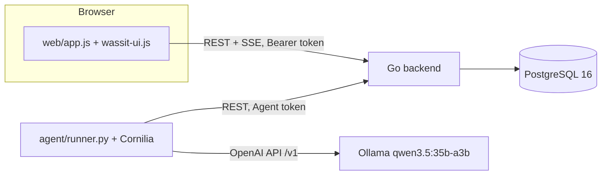
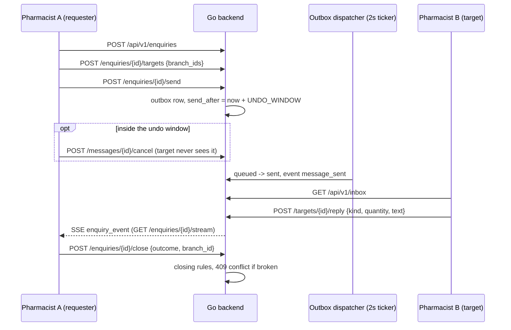
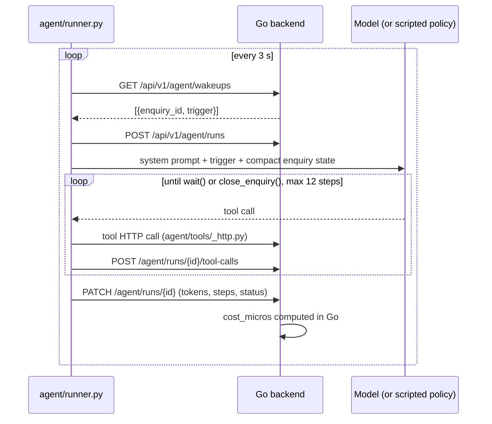
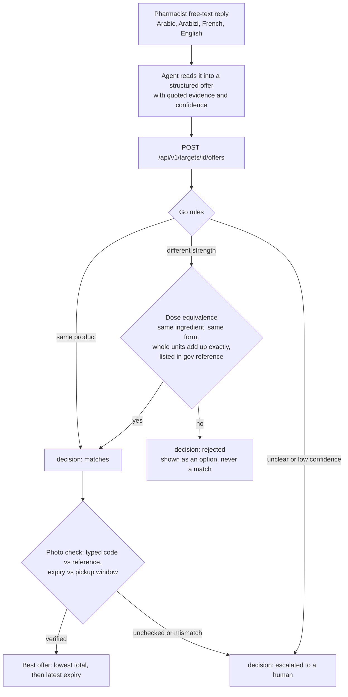
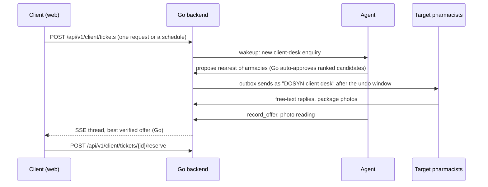

# Architecture

Code decides what is allowed. The model only decides what to do next.

## Components

| Component | Path | Tech | Role | Port |
| --- | --- | --- | --- | --- |
| Backend | `backend/` | Go 1.25, stdlib router, pgx, hand-written SQL | REST API, all product rules, outbox dispatcher, SSE | 8080 (demo 8113) |
| Database | `backend/db/` | PostgreSQL 16 in Docker, migrations 0001 to 0010 | storage | 5432 (demo 5573) |
| Agent | `agent/` | Python 3.13, Cornilia v0.1.0 | polls wakeups, one tool loop per enquiry, acts only over HTTP with its own credential | none (client only) |
| Model | external | Ollama `qwen3.5:35b-a3b`, thinking off | chooses the next tool call | 11434 |
| Web | `web/` | static HTML, CSS, JS | pharmacist and client UI, both on the live API | 5500 |
| Guard | `cornilia-guard/` | Go gateway + Python package | signed tool calls; not mounted yet, the agent uses `AGENT_TOKEN` | |

Backend layering, enforced by `backend/scripts/check_queries.sh`:
`handlers -> services -> queries -> PostgreSQL`, and `services -> ai`. Only `internal/queries`
touches the database; `internal/services` never imports `net/http`.

## Flow 1: pharmacist enquiry (live)

## Flow 2: agent wake loop (live)

Wake triggers: `created`, `clarified`, `approved`, `reply`, `timer`, `scheduled`. Hitting the
step limit marks the run `failed` and leaves the enquiry open for a human.

## Flow 3: offer and rules decision

`target_offers.decision` is `matches | escalated | rejected` and is set in Go. The model never
ranks offers and never marks an equivalent.

## Flow 4: client ticket (live, Phase 3B)

Tickets are enquiries from the "DOSYN client desk", so pharmacies never see client identity.
The old demo adapter (`web/wassit-demo.js`) was removed; the client side uses the live API.

## Data model

Source: `backend/db/migrations/` (authoritative) and `backend/db/schema.dbml`.

| Group | Tables | Migration |
| --- | --- | --- |
| Template chat loop | `agents`, `conversations`, `runs`, `messages`, `tool_calls` | 0001 |
| Pharmacy base | `branches`, `medications`, `inventory_batches`, `customers`, `prescriptions`, `carts`, `cart_items`, `orders`, `order_items`, `refill_subscriptions` | 0002, seed 0003 |
| Wassit enquiries | `staff`, `staff_sessions`, `enquiries`, `enquiry_targets`, `outbox_messages`, `enquiry_events`, `enquiry_agent_runs`, `enquiry_agent_tool_calls`; `branches` gains `lat`, `lng`, `participating` | 0004, seed 0005 |
| Offers | `target_offers` (structured offer per target, evidence, confidence, `decision`) | 0006 |
| Government reference | `gov_products`, `reference_documents` | 0007 |
| Clients | `clients`, `client_sessions`; desk branch and demo client seed | 0008 |
| Schedules and tickets | `medicine_schedules`, `client_tickets` | 0009 |
| Package photos | `package_photos` (typed code and expiry, agent reading, decision) | 0010 |

Chain: `enquiries -> enquiry_targets -> target_offers`; `enquiries -> outbox_messages`;
`enquiries -> enquiry_events` (append-only, with a stored inverse where reversible);
`enquiries -> enquiry_agent_runs -> enquiry_agent_tool_calls`. Ids are text UUIDs.
Column lists for the 0004 tables are in `CONTRACT.md`, section Data.

Enquiry status: `open | awaiting_clarification | awaiting_approval | waiting | closed | cancelled`.
Target status: `proposed | approved | sent | available | unavailable | alternative_offered | no_response | cancelled`.

## Where each product rule is enforced

Rule numbers are from `CONTRACT.md`.

| Rule | Enforced in | How |
| --- | --- | --- |
| 1. No substitution; equivalents only by rules | `backend/internal/services/enq_dose.go` (`EvaluateEquivalence`), `enq_offers.go`; `agent/prompts/system.md` | Go compares ingredient, form and exact unit sums and looks the product up in the reference; the prompt repeats the rule but is not relied on |
| 2. Only a human at the target branch replies | route tags in `backend/internal/handlers/` (`h.auth(staffOnly, ...)` on reply, approve, clarify, stock, uploads); `services/enq_replies.go` | agent credential gets 403 `agent_forbidden`; no agent tool marks stock available |
| 3. Silence is `no_response` | `services/enq_outbox.go` (follow-up, no-response) | only allowed after one follow-up; never `unavailable` |
| 4. Every change is an event with an inverse; derived decider | `services/enquiry_common.go`, `enq_outbox.go` (undo) | `enquiry_events` rows; `POST /events/{id}/undo` runs the stored inverse |
| 5. Outbox with undo window | `services/enq_outbox.go`, dispatcher started in `backend/cmd/server/main.go` | `send_after = now + UNDO_WINDOW` |
| 6. Closing rules | `services/enq_enquiries.go` | 409 `conflict` with a teaching message |
| 7. Agent works from DB data; asks when ambiguous | `agent/tools/catalogue.py`, `agent/tools/enquiry.py` (`ask_requester`) | tools only reach the backend API |
| 8. Client identity hidden; customers out of scope | no agent tool reads customer routes (`agent/tools/`); Phase 3B "client desk" design | |
| 9. Content filter | `services/content_filter.go` | 422 `content_filtered`, nothing stored or sent |
| 10. Photo is evidence, not proof | `services/photos.go`; reference lookup in `services/reference.go`; UI text in `web/wassit-ui.js` | code and expiry checked in Go; unclear photos wait for a staff reviewer |
| 11. Best offer in Go | `services/client_best.go` (`PickBestOffer`) | verified offers only: lowest total, then latest expiry |

Other fixed points: auth middleware and route tags in `backend/internal/handlers/`
(`enq_auth.go`, `enquiry_common.go`); error codes in `services/contracts.go`; speech in
`services/enq_speech.go`; stock update in `services/stock.go`; agent HTTP in
`agent/tools/_http.py`; token usage wrapper in `agent/usage.py`; scripted fallback policy in
`agent/scripted.py`.
